# CAD 로봇 모델을 MuJoCo로 옮겨 강화학습하기

Fusion 360에서 만든 로봇 3종을 MuJoCo 시뮬레이션으로 옮기고, Stable-Baselines3(PPO, SAC, SAC+HER)로 제어 정책을 학습했습니다. 학습 전에는 0~2%였던 성공률이 학습 후 80~100%로 올랐습니다. 보상 설계와 HER을 바꿔 가며 결과가 어떻게 달라지는지 비교 실험도 했습니다.

| 항목 | 내용 |
| --- | --- |
| 기간 | 2026.10 ~ 2026.11 (드론 및 로봇공학 수업 실습, 개인) |
| 로봇 | Ball & Beam, 2-Link Arm, Differential Drive |
| 도구 | Fusion 360, ACDC4Robot 1.1.1, MuJoCo 3.12.0, Gymnasium 1.4.0, Stable-Baselines3 2.9.0 |
| 결과 | 학습 후 성공률 80~100% (각 100 에피소드 평가) |
| 비교 실험 | 보상 설계 A vs B, 희소 보상에서 HER 유무 |

## 작업 흐름

```
Fusion 360 모델링 → ACDC4Robot export → <로봇>.xml + meshes/*.stl
                                            ↓ (원본은 두고 복사)
                                <로봇>_scene.xml  ← 모터, 충돌, 바닥, 목표 표시 추가
                                            ↓
                     <로봇>_env.py  (관찰, 행동, 보상, 종료 조건)
                                            ↓
         view_*.py (무작위 행동) → train_*.py (학습) → play_*.py (실행)
                                            ↓
         report/tools/train_eval.py (같은 100개 시작 조건에서 비교 평가)
```

| Fusion 모델 | 원본 export | 완성한 scene |
| --- | --- | --- |
| 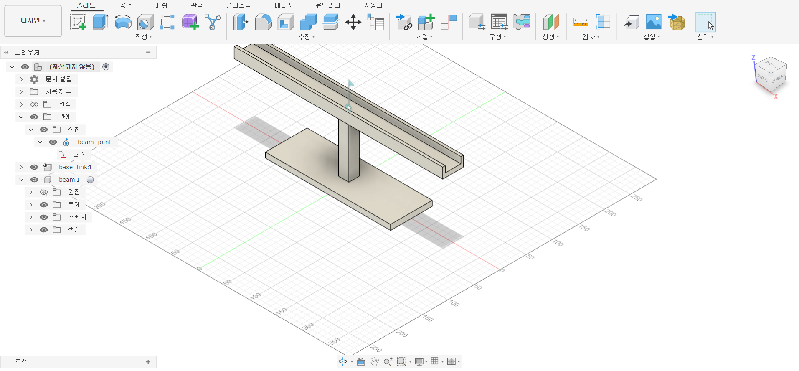 | 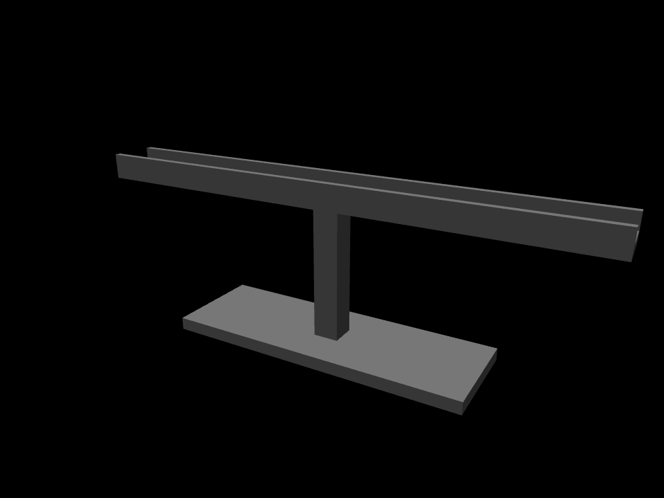 | 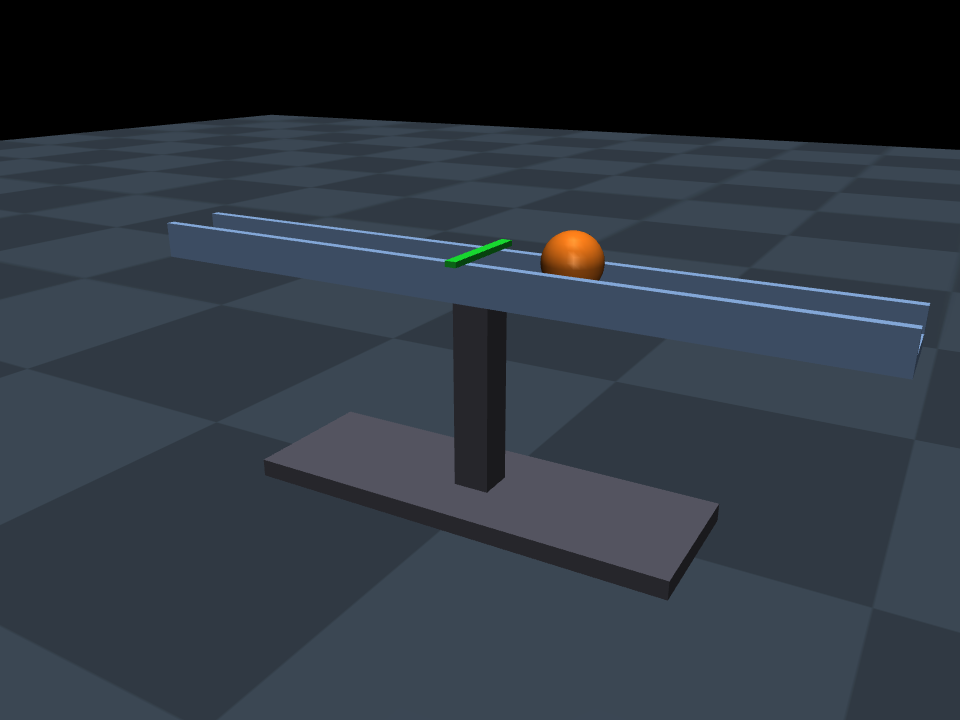 |
| 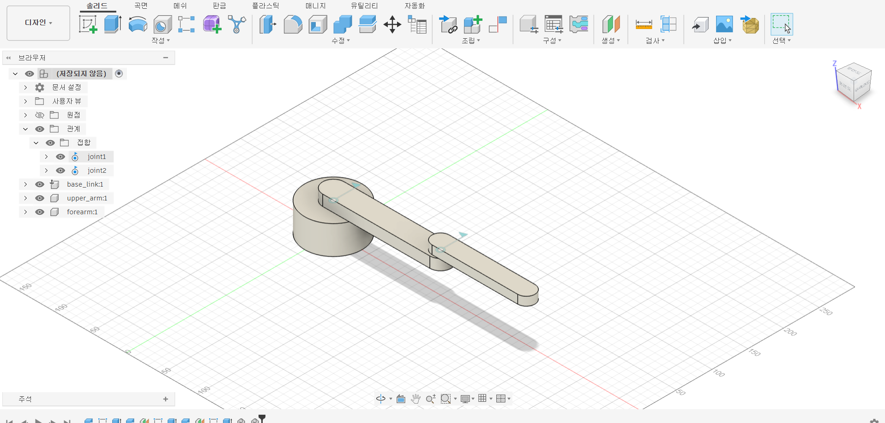 | 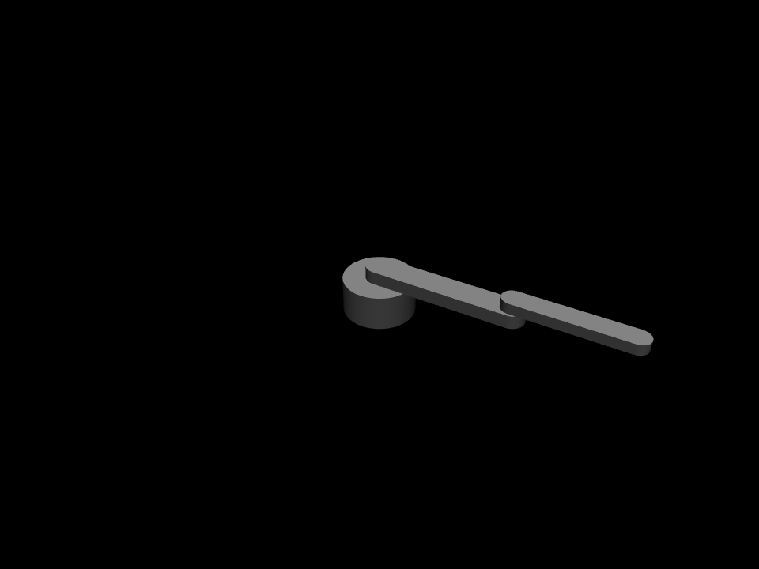 | 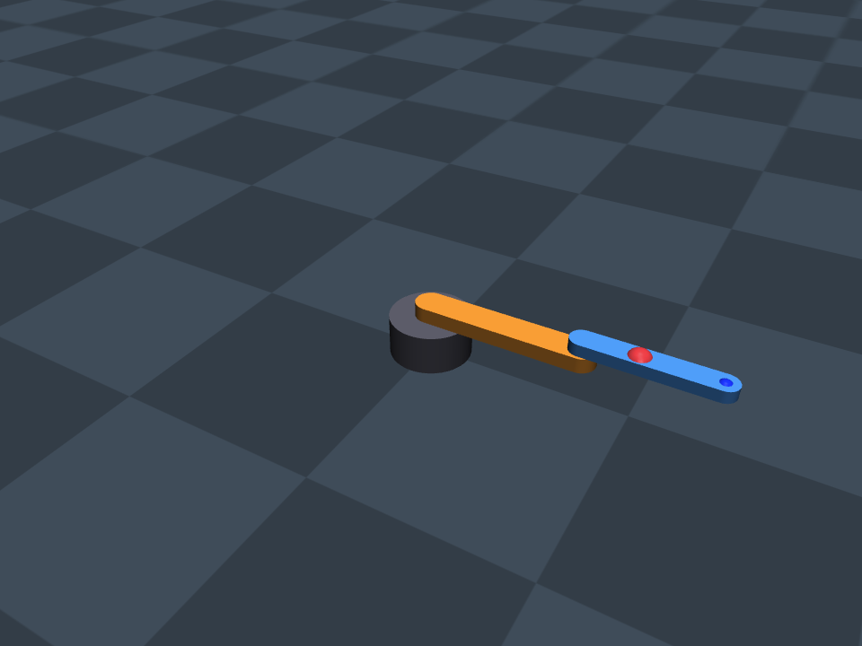 |
| 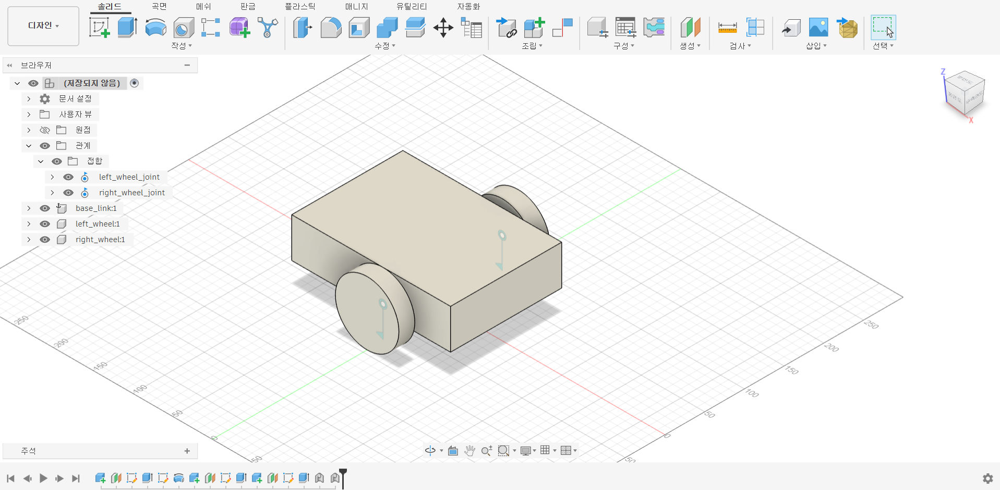 | 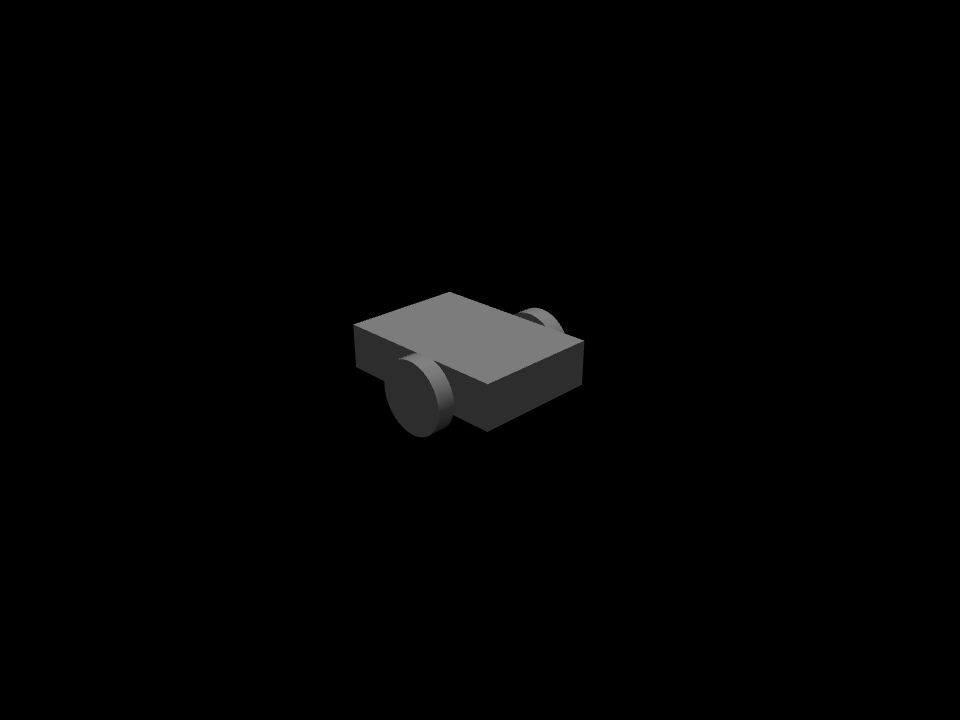 | 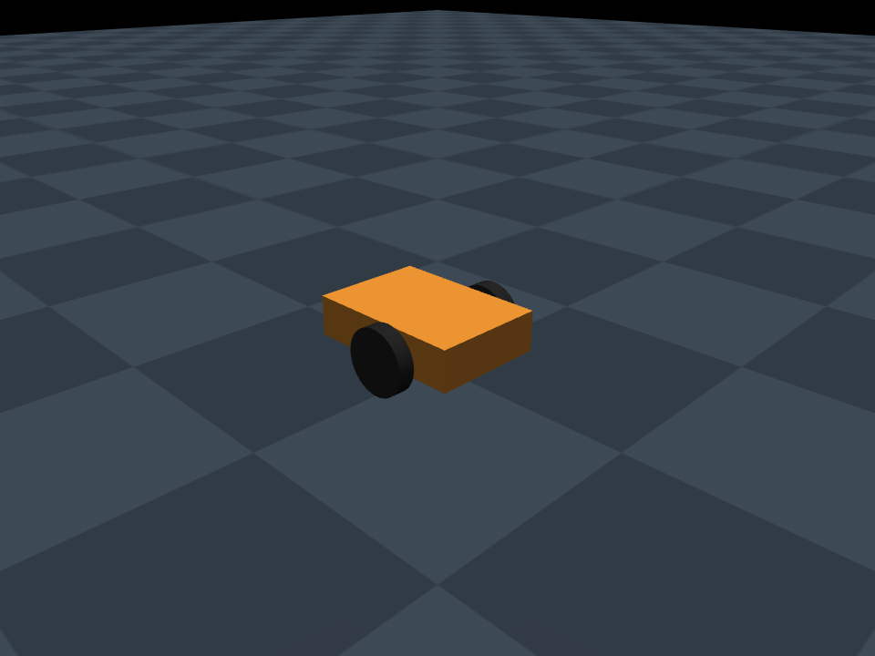 |

CAD에서 내보낸 파일에는 형상, 질량, 무게중심, 관성, 관절만 들어 있습니다. 바닥, 모터, 충돌 형상은 직접 추가했습니다. STL 메시는 충돌이 꺼진 채로 들어오기 때문에, 충돌은 상자·원기둥·구 같은 단순한 형상으로 따로 만들었습니다.

## 결과

| 실험 | 알고리즘 | 학습 스텝 | 무작위 | 학습 후 | 목표까지 최종 거리 |
| --- | --- | --- | --- | --- | --- |
| Ball & Beam | PPO | 200k | 0% | **88%** | 1.2 cm |
| Diff Drive | PPO | 100k | 0% | **100%** | 8.8 cm (반지름 10 cm 원판 안) |
| 2-Link Arm (dense) | SAC | 30k | 2% | **80%** | 1.6 cm |
| 2-Link Arm (sparse + HER) | SAC | 30k | 2% | **94%** | 0.9 cm |

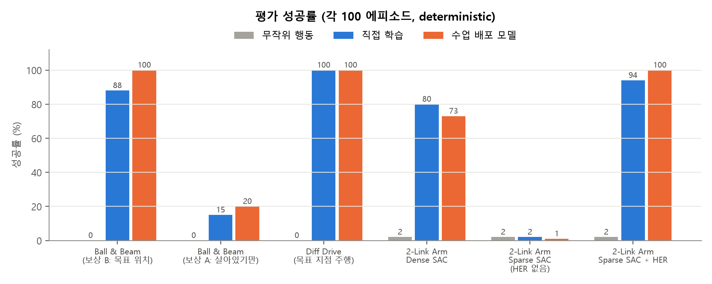

| 학습 전 (무작위) | 학습 후 |
| --- | --- |
| 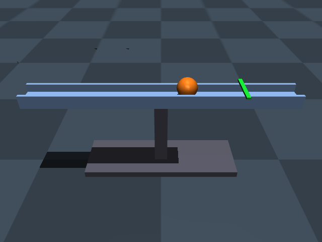 |  |
| 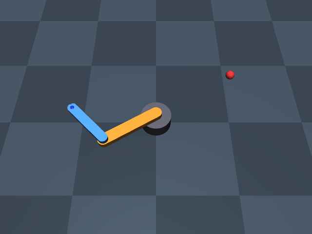 |  |
| 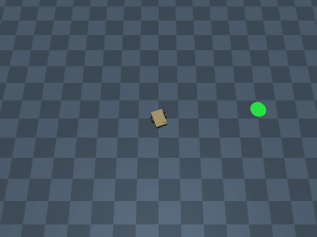 |  |

## 비교 실험

### 보상이 과제를 정의한다: Ball & Beam 보상 A vs B

| | 보상 A (공이 위에 있으면 +1) | 보상 B (+1 − 거리 − 속도 − 행동 벌점) |
| --- | --- | --- |
| 평균 보상 | **250.0 (최대값)** | 221.3 |
| 성공률 | 15% | **88%** |
| 최종 거리 | 7.1 cm | 1.2 cm |

보상 A로 학습한 에이전트는 보상 최대값을 받았지만, 목표 위치에 공을 세운 비율은 15%였습니다. 에이전트는 사람이 의도한 것이 아니라 보상으로 정해 준 것만 배웁니다.

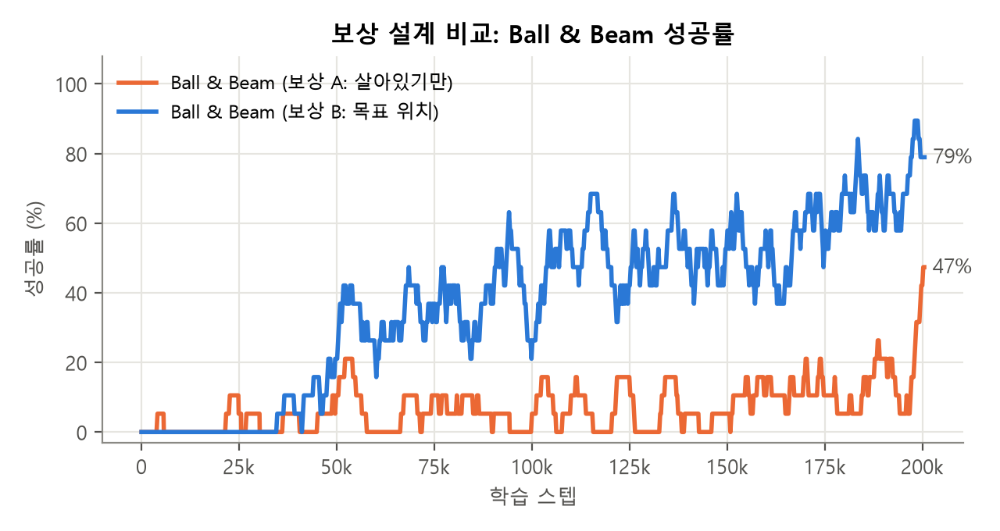

### 희소 보상과 HER: 2-Link Arm

| | dense | sparse (HER 없음) | sparse + HER |
| --- | --- | --- | --- |
| 성공률 | 80% | 2% | **94%** |
| 최종 거리 | 1.6 cm | 19.5 cm | 0.9 cm |

희소 보상(성공 0 / 실패 −1)만 주면 무작위 행동과 같은 2%에 머물렀습니다. 거의 모든 경험의 보상이 −1이라 어떤 행동이 나은지 구별할 정보가 없기 때문입니다. HER을 붙이자 보상 함수는 그대로인데 94%가 되었고, 가중치를 직접 설계한 dense 보상(80%)보다도 높았습니다.

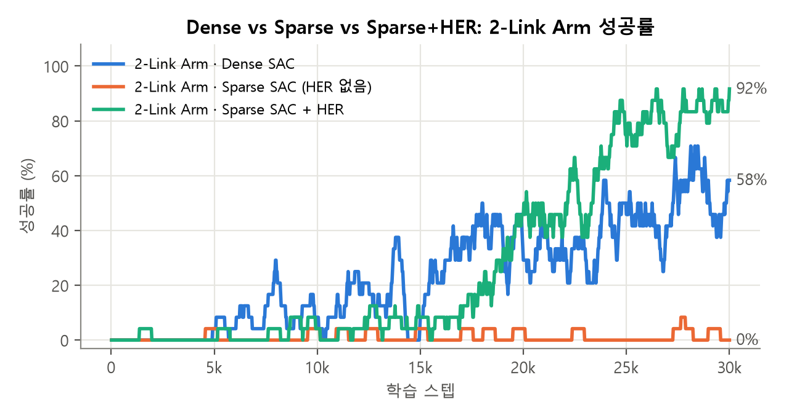

## 문제 해결

- **MuJoCo DLL 차단:** Windows 11 스마트 앱 컨트롤이 서명되지 않은 MuJoCo 라이브러리(`_specs.cp311-win_amd64.pyd`)를 막아 `import mujoco`가 실패했습니다. 이벤트 뷰어의 Code Integrity 로그로 원인을 찾았습니다. 보안 설정을 끄는 대신 WSL2 Ubuntu에 같은 버전 패키지를 설치하고, EGL 오프스크린 렌더링(`MUJOCO_GL=egl`)으로 학습과 이미지 저장을 했습니다.
- **접촉력 화살표가 지나치게 큼:** MuJoCo는 접촉력 화살표 길이를 모델의 평균 질량으로 나눠 정합니다. Ball & Beam의 공이 30 g으로 가벼워 화살표가 화면 밖까지 나갔고, 표시 배율을 모델에 맞게 줄였습니다.

## 배운 점

- CAD export는 형상과 질량 특성까지만 정확합니다. 모터 게인, 충돌 형상, 마찰처럼 실제 움직임을 결정하는 값은 사람이 넣어야 하고, 이 값이 실제와 다르면 sim-to-real 문제가 생깁니다.
- 강화학습에서는 알고리즘 선택만큼 보상을 어떻게 주는지가 중요합니다.
- 시뮬레이션에서는 목표 위치와 시작 자세를 바꿔 가며 수천 번 반복할 수 있습니다. 실제 로봇으로는 시간과 비용이 훨씬 많이 드는 일입니다.

자세한 환경 설계와 학습 곡선은 [docs/보고서.md](docs/보고서.md)에 있습니다.

## 실행

```bash
pip install -r requirements.txt

python view_ball_beam.py           # 무작위 행동으로 장면 확인
python train_ball_beam.py          # 학습 (모델이 이 폴더에 저장됨)
python play_ball_beam.py           # 학습한 모델 실행

python report/tools/train_eval.py ball_beam   # 학습 + 100 에피소드 평가 → report/
python report/tools/make_figures.py           # 그래프·GIF 생성
```

`train_eval.py`의 job 이름: `ball_beam`, `ball_beam_alive`, `diff_drive`, `arm_dense`, `arm_sparse`, `arm_sparse_her`

## 폴더 구조

```
ball_beam/, two_link_arm/, diff_drive/   Fusion export 원본(<로봇>.xml), 완성한 장면(<로봇>_scene.xml), STL
*_env.py                                 Gymnasium 학습 환경
view_*.py / train_*.py / play_*.py        장면 확인 / 학습 / 실행
report/tools/                            train_eval.py (학습·평가), make_figures.py (그래프·GIF)
report/models/                           직접 학습한 모델 6개
report/logs/, report/results/            학습 로그(CSV), 평가 결과(JSON)
report/figures/, report/captures/        그래프, 장면 이미지, GIF, Fusion 캡처
docs/                                    보고서
```

## 출처

- **수업 튜토리얼 제공:** `*_env.py`, `view_*.py`, `train_*.py`, `play_*.py`, `<로봇>_scene.xml`, 로봇 형상. 수업 배포 모델과 실습 정답 파일은 저장소에 넣지 않았습니다.
- **직접 작성:** `report/tools/`의 학습·평가·그래프 스크립트, `report/`의 모델·로그·결과·그림, 문서.
- **외부 도구:** [ACDC4Robot](https://github.com/bionicdl-sustech/ACDC4Robot) (Fusion 360 → MJCF 변환 애드인)
