# MuJoCo 실습 보고서: Fusion 360 로봇 모델을 MuJoCo로 가져와 강화학습하기

## 1. 개요

CAD로 만든 로봇을 MuJoCo 시뮬레이터로 옮기고, 그 안에서 강화학습으로 제어 정책을 학습시키는 과정을 처음부터 끝까지 진행했습니다.

1. Fusion 360에서 로봇을 모델링하고 관절을 정의합니다.
2. ACDC4Robot 애드인으로 MuJoCo 모델 파일(MJCF, XML)을 내보냅니다.
3. 내보낸 XML에 모터, 충돌 형상, 바닥을 추가해 시뮬레이션 장면을 완성합니다.
4. Gymnasium 형식의 학습 환경(관찰, 행동, 보상)을 정의합니다.
5. Stable-Baselines3의 PPO, SAC로 학습시키고 학습 전과 후를 비교합니다.

대상은 Ball & Beam(판을 기울여 공을 목표 위치에 세우기), 2-Link Arm(2관절 팔의 손끝을 목표점에 가져가기), Differential Drive(2륜 이동로봇을 목표 지점까지 주행시키기) 세 가지입니다.

### 1.1 실습 환경

| 항목 | 내용 |
| --- | --- |
| OS | Windows 11, WSL2 Ubuntu 24.04 (학습 및 렌더링, 6장 참고) |
| Python | 3.11.9 (Windows 가상환경), 3.12.3 (WSL) |
| 주요 패키지 | mujoco 3.12.0, stable-baselines3 2.9.0, gymnasium 1.4.0, torch 2.14.1 (Windows) / 2.15 CPU (WSL) |
| CAD | Autodesk Fusion 360, ACDC4Robot 1.1.1 |
| 에디터 | VS Code |

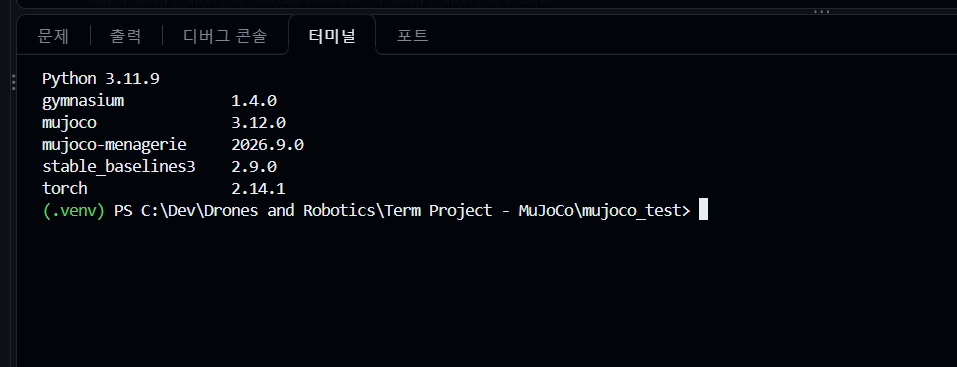

## 2. CAD 모델에서 시뮬레이션 장면까지

### 2.1 Fusion 360 모델링

세 로봇 모두 부품마다 컴포넌트를 따로 만들고, 바닥에 고정되는 부분은 `base_link` 컴포넌트로 두었습니다. 움직이는 부분은 Revolute(회전) 관절로 연결했습니다.

| 로봇 | 관절 | 모델 | 관절 설정 |
| --- | --- | --- | --- |
| Ball & Beam | beam_joint: Y축 회전, −15°~15° 제한 | 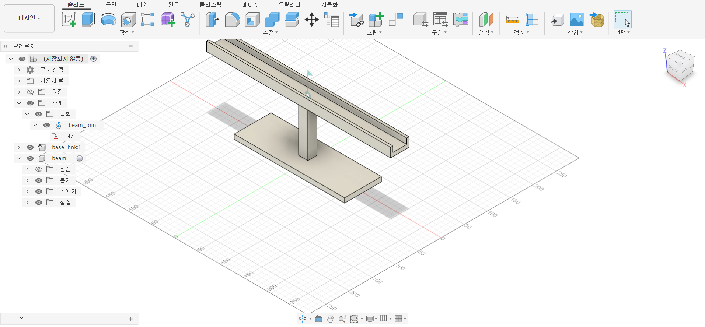 | 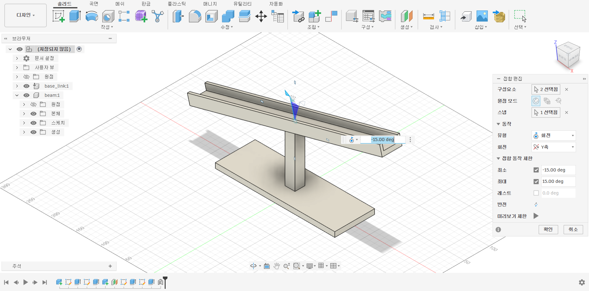 |
| 2-Link Arm | joint1, joint2: 회전, 제한 없음 | 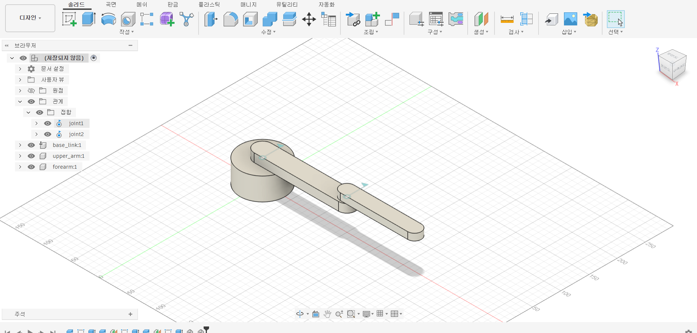 | 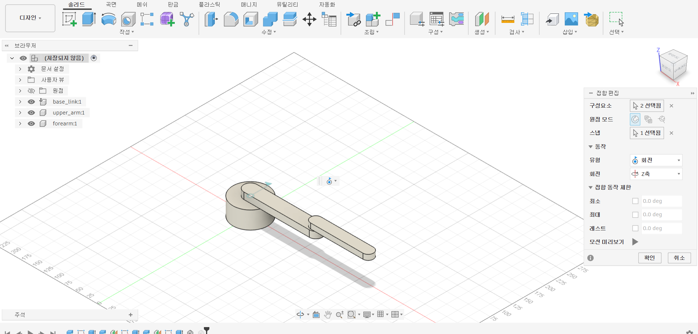 |
| Diff Drive | 좌우 바퀴: 회전, 제한 없음 | 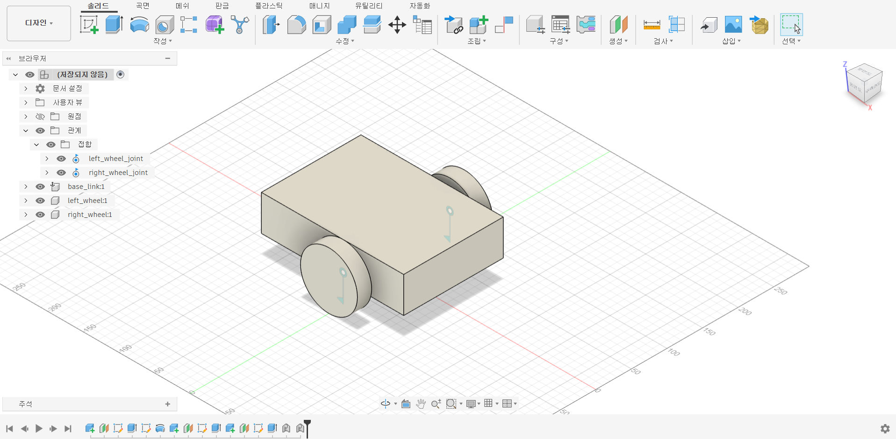 | 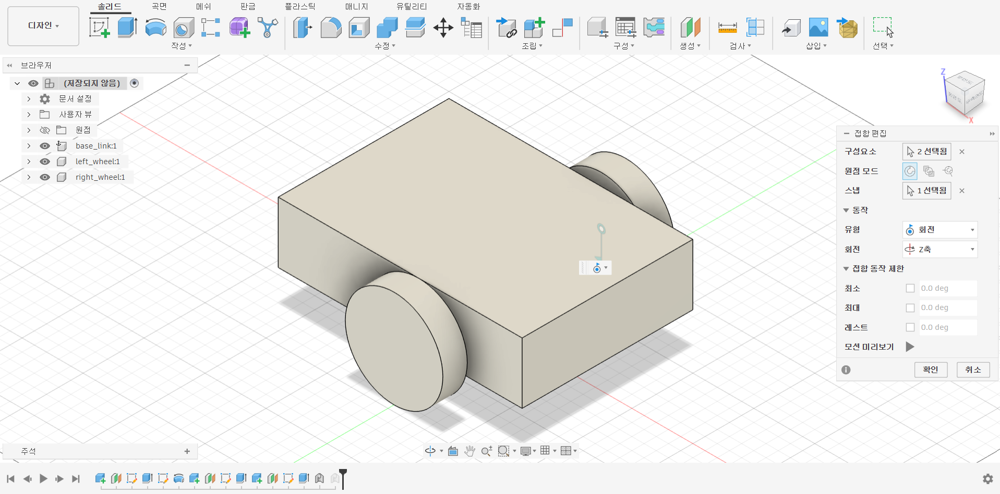 |

### 2.2 ACDC4Robot으로 MJCF 내보내기

ACDC4Robot은 Fusion 어셈블리를 MuJoCo가 읽을 수 있는 MJCF로 변환하는 애드인입니다. 내보내기 전에 어셈블리 구조를 먼저 검사하고, 아래와 같은 경우에는 파일을 만들지 않고 멈춥니다.

- 관절이 Fusion의 root(ground)에 직접 연결된 경우. 고정되는 부분도 `base_link` 같은 컴포넌트로 만들어야 합니다.
- 회전 관절이나 직선 관절의 원점(origin)이 없는 경우. MuJoCo에서 축 위치를 알 수 없기 때문입니다.
- 원통형·볼 조인트처럼 지원하지 않는 관절, 이름 중복, 연결이 끊어진 링크가 있는 경우.

내보낸 파일에는 형상(STL), 질량, 무게중심, 관성 텐서, 관절 정보만 들어 있습니다. 모터, 센서, 충돌 형상, 바닥은 일부러 넣지 않습니다. CAD에 없는 값을 임의로 만들지 않고 사용자가 직접 넣도록 한 설계입니다.

반대로 Fusion에서 정한 값은 그대로 넘어옵니다. Ball & Beam의 beam 관절은 Fusion에서 Y축 회전, −15°~15° 제한으로 설정했고, 내보낸 XML에도 `axis="0 1 0"`, `range="-0.261799 0.261799"`(rad, ±15°)로 들어가 있었습니다.

| 내보내기 설정 | 결과 폴더 |
| --- | --- |
| 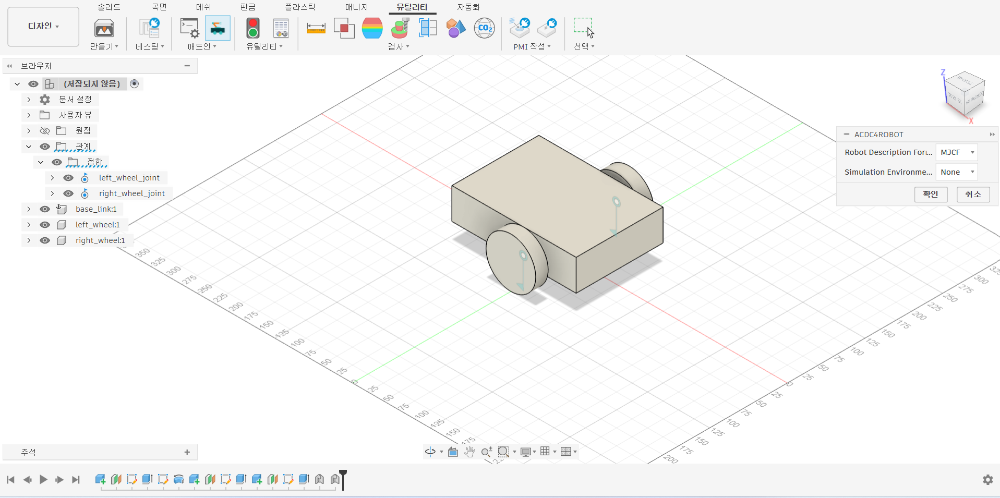 | 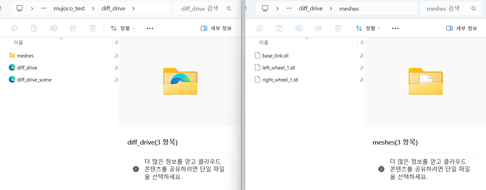 |

### 2.3 시뮬레이션 장면 완성

내보낸 원본 XML을 그대로 열면 바닥도 모터도 없어서 로봇이 허공에 떠 있습니다. 원본은 그대로 두고 복사본(`<로봇>_scene.xml`)을 만들어 필요한 요소를 추가했습니다.

| 원본 export | 완성한 scene |
| --- | --- |
| 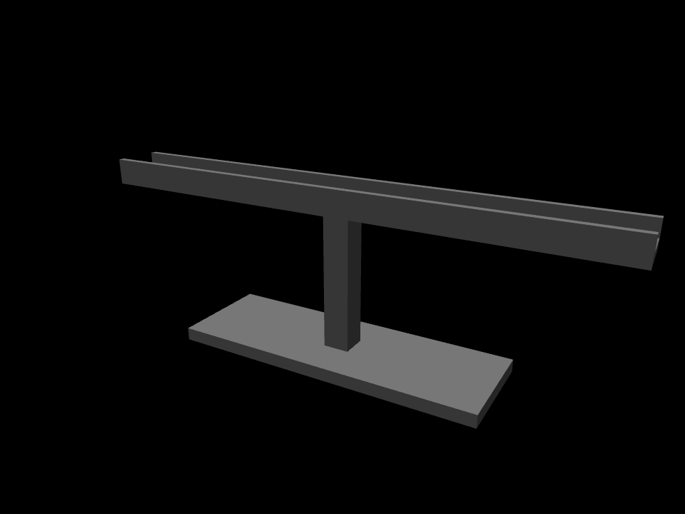 |  |
| 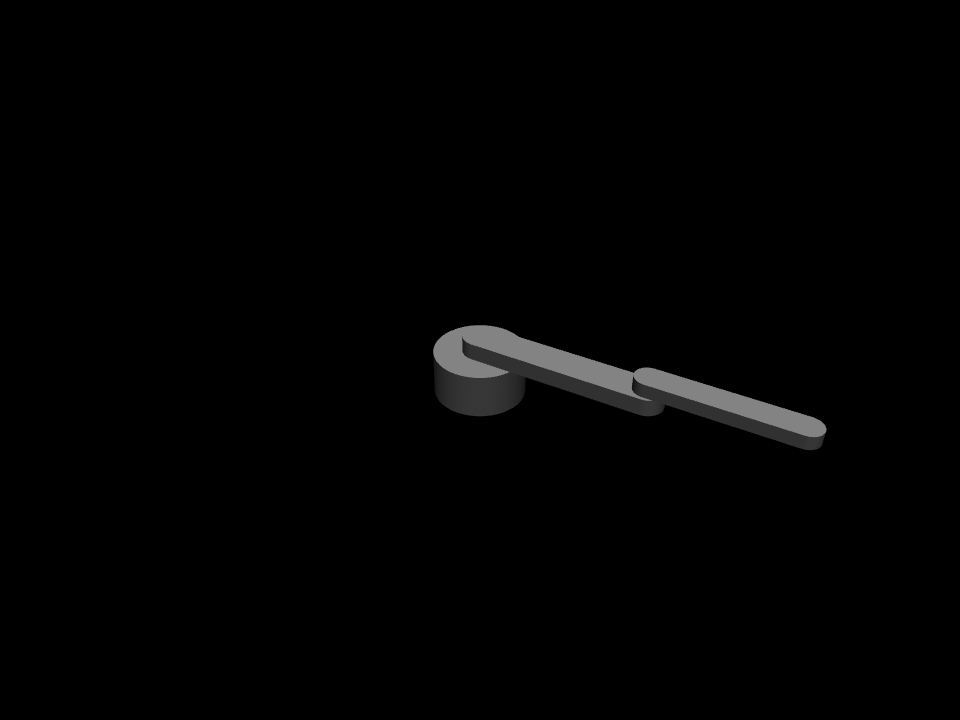 |  |
| 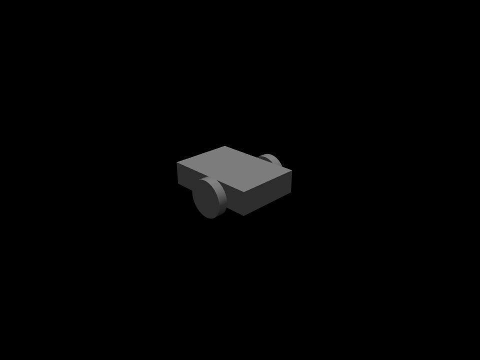 | 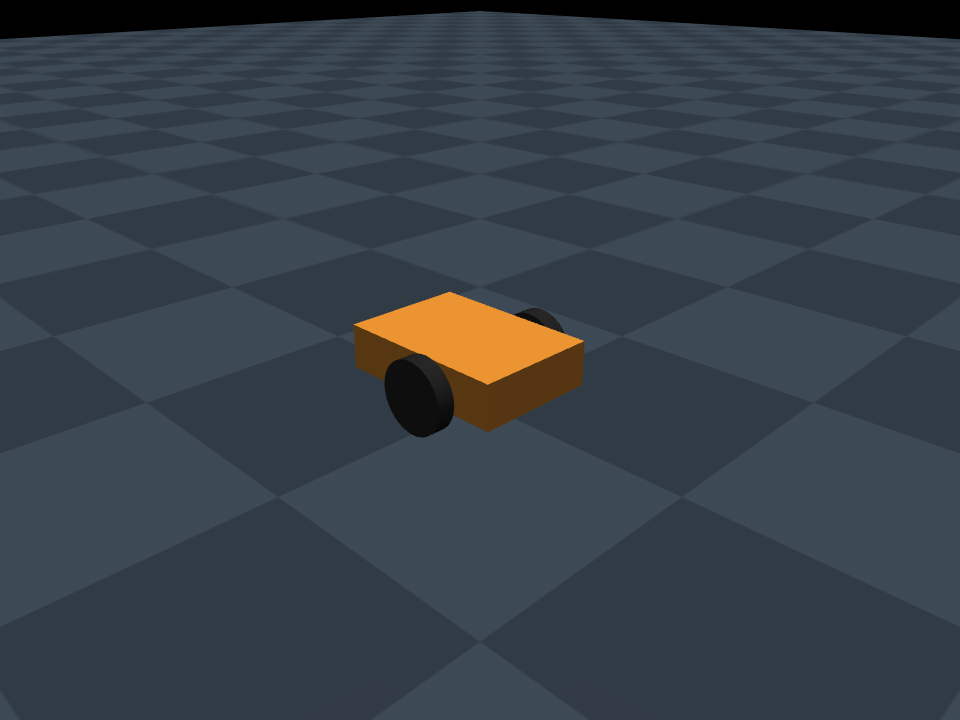 |

| 로봇 | 추가한 요소 |
| --- | --- |
| Ball & Beam | beam 충돌 상자 3개(바닥판, 양쪽 레일), 목표 표시(site), 공(freejoint + 구), 바닥, 위치 제어 모터(position, kp=10, kv=0.3, 범위 ±15°) |
| 2-Link Arm | 관절 감쇠(damping=0.05), 손끝 표시(site), 목표 표시(site), 바닥, 토크 모터 2개(motor, ±0.2 N·m) |
| Diff Drive | 몸체 freejoint, 볼캐스터 충돌 구(마찰 0.01), 바퀴 충돌 원기둥 2개, 바닥, 목표 원판, 속도 모터 2개(velocity, kv=0.05, ±15 rad/s) |

내보낸 STL 메시는 충돌이 꺼진 상태(`contype="0" conaffinity="0"`)로 들어오기 때문에, 충돌은 상자·원기둥·구 같은 단순한 형상으로 따로 만들었습니다. 복잡한 메시를 그대로 쓰는 것보다 접촉 계산이 안정적이고 빠릅니다.

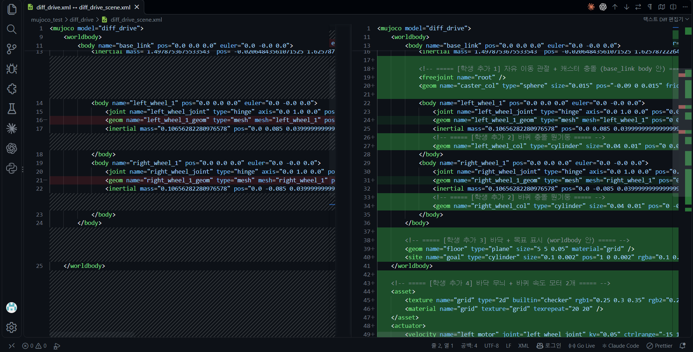

### 2.4 모델 확인

관절 축과 접촉력을 표시해서 모델이 제대로 연결됐는지 확인했습니다.

| Ball & Beam | 2-Link Arm | Diff Drive |
| --- | --- | --- |
| 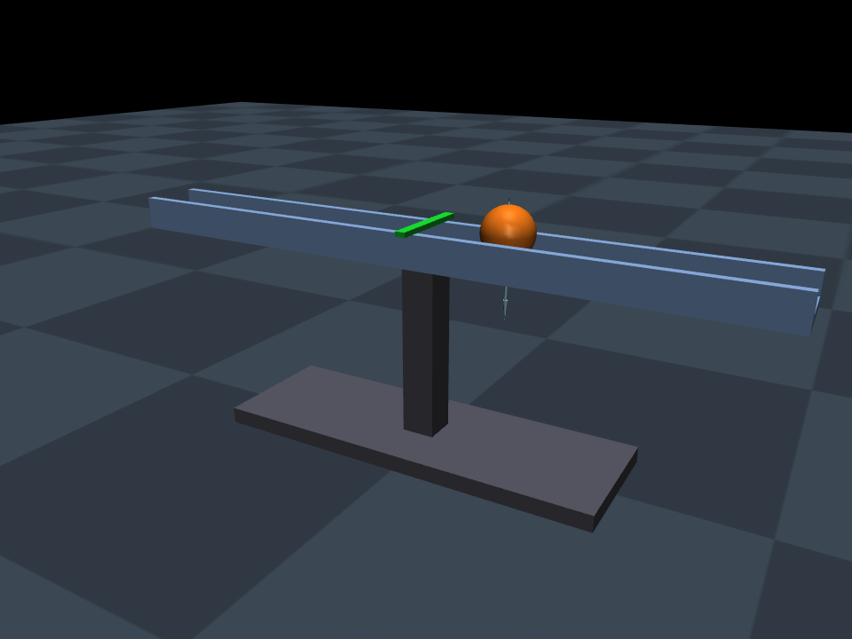 | 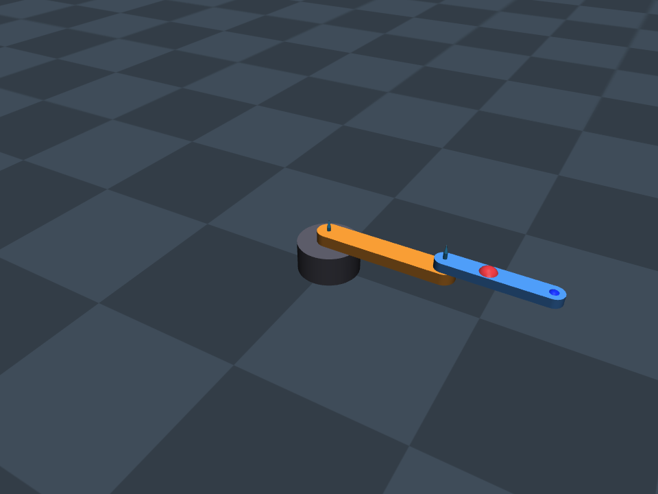 | 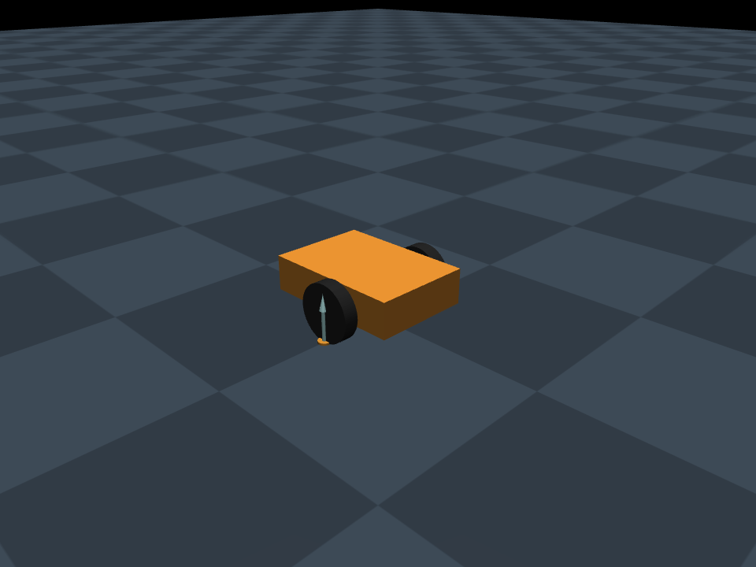 |

- Ball & Beam: 공과 beam 사이의 접촉력이 보입니다.
- 2-Link Arm: 두 관절 축이 모두 세로 방향이라 팔이 책상 위에서 수평으로 돕니다.
- Diff Drive: 바퀴 두 개와 캐스터가 바닥에서 몸체 무게를 나눠 받습니다.

## 3. 강화학습 환경 설계

에이전트는 관찰(observation)을 보고 행동(action)을 정하고, 시뮬레이션이 한 스텝 진행되면 보상(reward)을 받습니다. 각 로봇의 환경은 `*_env.py`에 Gymnasium의 `reset()`, `step()` 형식으로 정의되어 있습니다. 관절과 모터를 이름으로 찾기 때문에 Fusion에서 다시 내보내도 이름만 같으면 그대로 쓸 수 있습니다.

| | Ball & Beam | 2-Link Arm | Diff Drive |
| --- | --- | --- | --- |
| 과제 | 공을 무작위 목표 위치에 멈추기 | 손끝을 무작위 목표점에 가져가기 | 무작위 목표(0.3~1.5 m)까지 주행 |
| 관찰 | 5개: 공 위치·속도, beam 각도·각속도, 목표까지 거리 | 12개: 관절각(cos, sin), 관절 속도, 손끝·목표 좌표와 차이 | 7개: 로봇 기준 목표 좌표·거리·방향, 전진·회전 속도 |
| 행동 | beam 목표 각도 (±15°) | 관절 토크 2개 | 좌·우 바퀴 속도 |
| 보상 | +1 (공이 위에 있음) − 5 × 거리 − 0.5 × 공 속도 − 0.05 × 행동² | − 5 × 거리 − 0.05 × 행동² + 1 (2 cm 이내) | +10 × 가까워진 거리 − 0.05 (매 스텝) + 10 (도착) |
| 제어 주기 | 50 Hz | 12.5 Hz | 20 Hz |
| 에피소드 | 250 스텝(5초), 공이 떨어지면 종료 | 25 스텝(2초) | 200 스텝(10초), 도착하면 종료 |
| 성공 기준 | 목표 2 cm 이내, 속도 5 cm/s 미만 | 손끝이 목표 2 cm 이내 | 목표 원판(반지름 10 cm) 안 |
| 알고리즘 | PPO, 200,000 스텝 | SAC, 30,000 스텝 | PPO, 100,000 스텝 |

환경 코드를 읽으면서 설계에서 눈에 띈 점이 있었습니다.

- **Diff Drive의 관찰은 로봇 기준 좌표입니다.** 로봇이 어느 방향을 보고 있든 "목표가 왼쪽 앞에 있으면 왼쪽으로 돈다"는 같은 규칙을 쓸 수 있어 학습이 쉬워집니다.
- **Diff Drive의 보상은 이전 스텝보다 가까워진 만큼 줍니다.** 거리 자체에 보상을 주면 목표 근처를 빙빙 돌며 보상을 모으는 행동이 생길 수 있는데, 변화량 보상에서는 그런 행동에 이득이 없습니다.
- **2-Link Arm은 관절 각도를 cos, sin 값으로 넣습니다.** −180°와 +180°는 같은 자세인데 숫자로는 멀리 떨어져 있어서, 각도를 그대로 넣으면 신경망이 헷갈릴 수 있습니다.

### 3.1 알고리즘

| | PPO | SAC (+HER) |
| --- | --- | --- |
| 방식 | On-policy: 현재 정책으로 모은 데이터만 사용 | Off-policy: Replay Buffer에 쌓인 과거 경험을 재사용 |
| 특징 | 정책을 조금씩(clipping) 바꿔 안정적 | 적은 스텝으로도 학습 가능 |
| 사용 | Ball & Beam, Diff Drive | 2-Link Arm (에피소드가 2초로 짧아 gamma=0.95, 64×64 신경망) |

## 4. 학습 결과

### 4.1 측정 방법

- 수업에서 받은 `train_*.py`와 같은 알고리즘, 같은 하이퍼파라미터로 직접 다시 학습했습니다(`seed=0`).
- 학습 중에는 에피소드마다 보상과 성공 여부를 `Monitor` CSV로 기록했습니다.
- 학습이 끝난 뒤 같은 100개의 시작 조건(seed 1000~1099)에서 무작위 행동, 직접 학습한 모델, 수업 배포 모델을 각각 실행해 성공률을 비교했습니다(deterministic).
- 스크립트: [report/tools/train_eval.py](../report/tools/train_eval.py), [report/tools/make_figures.py](../report/tools/make_figures.py)

### 4.2 평가 결과 (각 100 에피소드)

| 실험 | 알고리즘 | 학습 스텝 | 학습 시간* | 무작위 | 직접 학습 | 배포 모델 | 최종 거리 |
| --- | --- | --- | --- | --- | --- | --- | --- |
| Ball & Beam | PPO | 200k | 5.2분 | 0% | **88%** | 100% | 1.2 cm |
| Diff Drive | PPO | 100k | 2.8분 | 0% | **100%** | 100% | 8.8 cm |
| 2-Link Arm (dense) | SAC | 30k | 6.0분 | 2% | **80%** | 73% | 1.6 cm |
| 2-Link Arm (sparse + HER) | SAC | 30k | 7.0분 | 2% | **94%** | 100% | 0.9 cm |

\* 실험 6개를 동시에 병렬로 돌렸을 때 기준 (CPU 14코어)

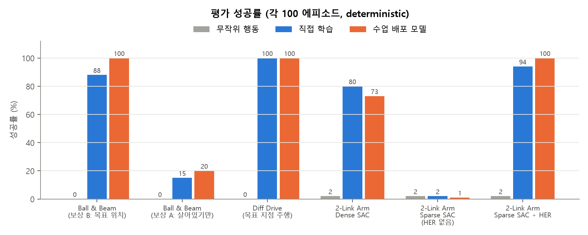

무작위로 움직일 때는 세 로봇 모두 거의 성공하지 못했지만(0~2%), 학습 후에는 80~100% 성공했습니다. 직접 학습한 모델은 배포 모델과 비슷한 수준이었고, 2-Link Arm dense는 오히려 조금 높았습니다. Diff Drive의 최종 거리 8.8 cm는 반지름 10 cm 원판 안에 들어오면 바로 종료되기 때문에 나온 값입니다.

전체 수치: [report/results/summary.md](../report/results/summary.md)

### 4.3 학습 곡선

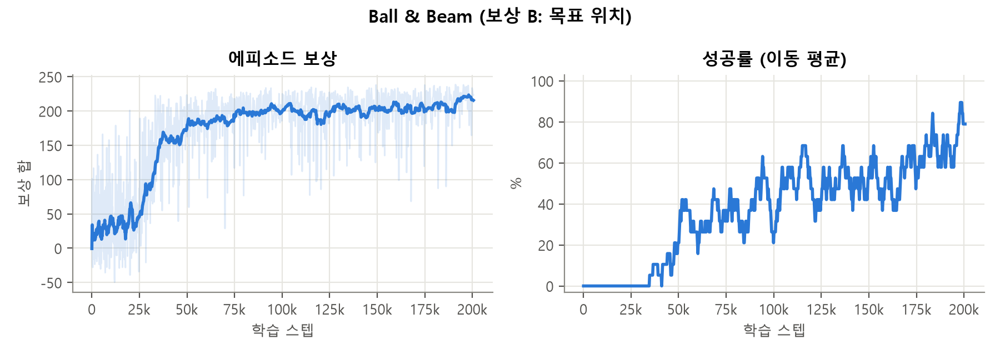

Ball & Beam은 처음 약 3만 5천 스텝 동안 성공이 한 번도 없었습니다. 이 구간에서도 보상은 먼저 올라가는데, 공을 떨어뜨리지 않는 것(+1/스텝)부터 배운 것으로 보입니다. 그다음 공을 목표 쪽으로 옮기는 법을 익히면서 성공률이 올라갔습니다.

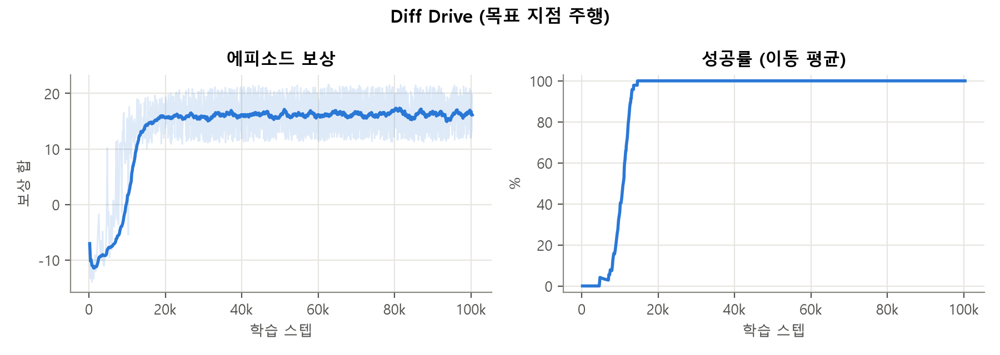

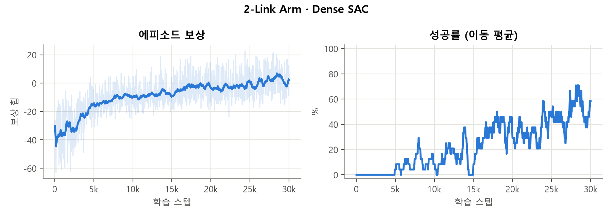

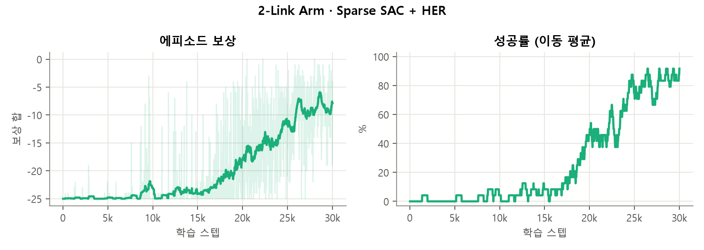

학습 중 성공률이 평가 결과보다 낮게 나오는 것은, 학습할 때는 탐험을 위해 행동에 무작위성이 섞이고 평가할 때는 `deterministic=True`로 가장 좋은 행동만 고르기 때문입니다.

### 4.4 학습 전과 후 비교

같은 시작 조건(같은 seed)에서 학습 전 무작위 행동(위)과 학습 후 정책(아래)을 실행하고, 같은 시점의 화면을 나란히 놓았습니다.

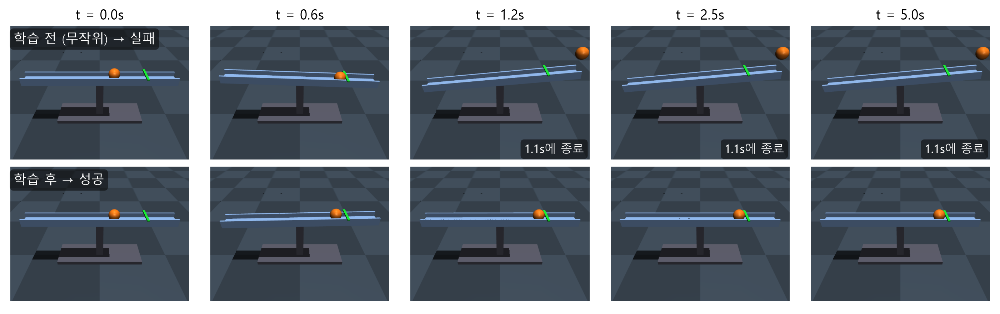

Ball & Beam: 무작위 행동은 약 1초 만에 공이 떨어지고, 학습 후에는 beam을 기울였다가 다시 수평으로 돌려 공을 초록 목표선에 멈춥니다.

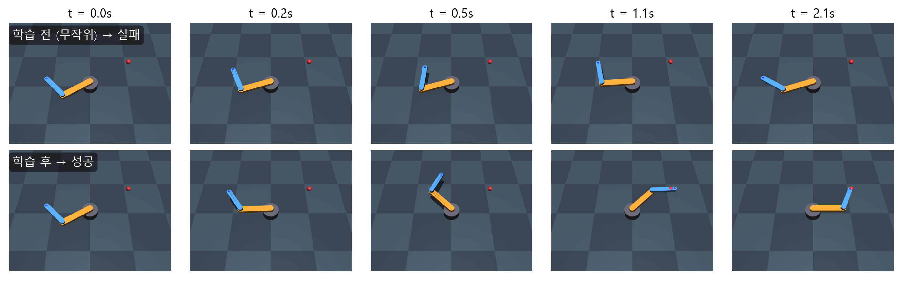

2-Link Arm (sparse + HER): 무작위 행동은 제자리에서 흔들리기만 하고, 학습 후에는 약 1초 안에 손끝(파란 점)을 빨간 목표점에 가져갑니다.

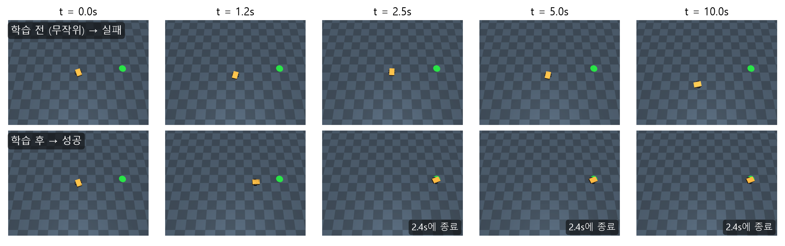

Diff Drive: 무작위 행동은 10초 동안 목표에 가지 못하고, 학습 후에는 방향을 틀어 약 2.4초 만에 초록 원판에 도착합니다.

## 5. 비교 실험

### 5.1 보상 설계에 따른 차이 (Ball & Beam)

같은 환경에서 보상만 다르게 해서 학습시켰습니다. 보상 A는 공이 beam 위에 있기만 하면 매 스텝 +1을 주고 목표 위치는 보지 않습니다. 보상 B는 목표까지 거리와 공 속도에 벌점을 줍니다.

| | 보상 A (살아있기만) | 보상 B (목표 위치 고려) |
| --- | --- | --- |
| 평균 보상 | 250.0 (최대값) | 221.3 |
| 성공률 | 15% | 88% |
| 목표까지 최종 거리 | 7.1 cm | 1.2 cm |

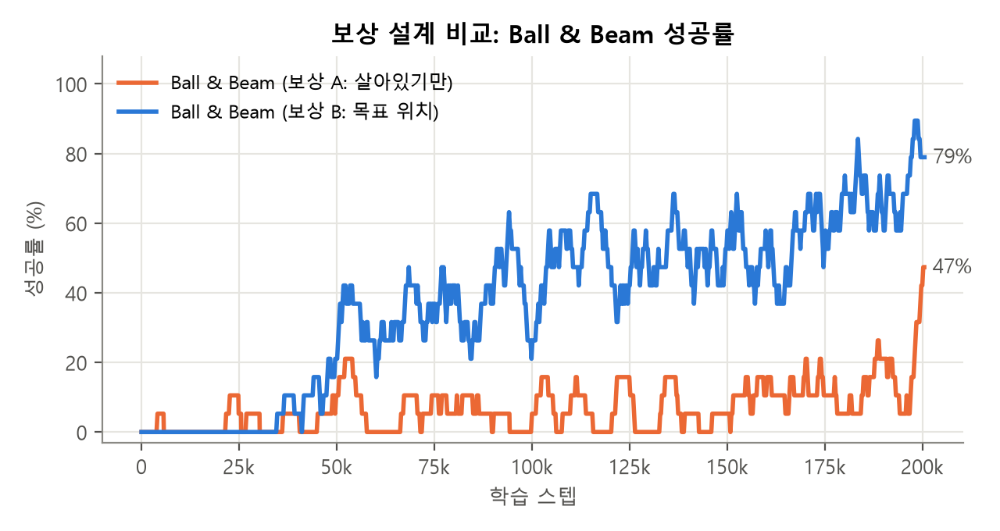

보상 A로 학습한 모델은 100번 모두 보상 최대값 250을 받았습니다. 공을 한 번도 떨어뜨리지 않았다는 뜻입니다. 그런데 목표에는 관심이 없으니 성공률은 15%밖에 되지 않았고, 이것도 공이 우연히 목표 근처에서 멈춘 경우입니다. 보상 기준으로는 A가 더 잘한 것처럼 보이지만 실제로 원하던 과제는 하지 못했습니다. 에이전트는 사람이 의도한 것이 아니라 보상으로 정해 준 것만 배운다는 것을 확인했습니다.

### 5.2 희소 보상과 HER (2-Link Arm)

보상을 주는 방식을 세 가지로 바꿨습니다. dense는 거리에 비례한 벌점을 매 스텝 주는 방식이고, sparse는 목표 2 cm 안이면 0, 아니면 −1만 주는 방식입니다. sparse는 HER 없이 한 번, HER을 붙여서 한 번 학습했습니다.

| | dense | sparse (HER 없음) | sparse + HER |
| --- | --- | --- | --- |
| 성공률 | 80% | 2% | 94% |
| 목표까지 최종 거리 | 1.6 cm | 19.5 cm | 0.9 cm |

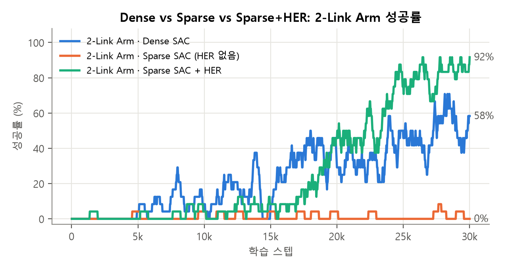

HER 없이 sparse 보상만 준 경우는 3만 스텝 동안 거의 학습되지 않았고, 성공률이 무작위 행동과 같은 2%였습니다. 무작위로 움직여서는 손끝이 2 cm 안에 들어가는 일이 거의 없어서, 거의 모든 경험의 보상이 −1이 됩니다. 그러면 어떤 행동이 더 나은지 구별할 정보가 없습니다.

HER(Hindsight Experience Replay)은 실패한 경험을 "손끝이 실제로 도착한 위치가 원래 목표였다"고 바꿔서 성공한 경험으로 한 번 더 저장합니다. 경험 하나당 4개의 목표를 바꿔 넣었습니다(`n_sampled_goal=4`, `future` 전략). 보상 함수는 그대로인데 성공률이 2%에서 94%로 올라갔고, 거리 보상을 직접 설계한 dense(80%)보다도 높았습니다. dense 보상은 거리, 행동, 보너스 가중치를 사람이 정해야 하지만, HER을 쓰면 성공 여부만 정의하면 됩니다. 다만 HER은 Replay Buffer에 저장된 과거 경험을 바꿔 쓰는 방법이라 SAC 같은 off-policy 알고리즘에서만 쓸 수 있습니다.

## 6. 문제 해결 과정

**MuJoCo 라이브러리 차단.** 다시 실행했을 때 `import mujoco`에서 "애플리케이션 제어 정책에서 이 파일을 차단했습니다"라는 오류가 났습니다. 이벤트 뷰어의 Code Integrity 로그를 확인해 보니, Windows 11의 스마트 앱 컨트롤이 서명되지 않은 MuJoCo 라이브러리 파일(`_specs.cp311-win_amd64.pyd`)을 막고 있었습니다. 스마트 앱 컨트롤은 한 번 끄면 Windows를 다시 설치하기 전에는 켤 수 없어서, 설정을 끄는 대신 WSL2 Ubuntu에 같은 버전의 패키지를 설치해 학습과 렌더링을 진행했습니다. 화면이 없는 환경이라 MuJoCo의 EGL 오프스크린 렌더링(`MUJOCO_GL=egl`)으로 이미지를 저장했습니다.

**접촉력 화살표 크기.** 처음 접촉력을 표시한 이미지를 뽑았을 때 화살표가 화면을 뚫고 나갈 만큼 길게 나왔습니다. MuJoCo는 접촉력 화살표 길이를 모델의 평균 질량으로 나눠 정하는데, Ball & Beam의 공은 30 g으로 매우 가벼워서 화살표가 지나치게 커진 것이었습니다. 표시 배율을 모델에 맞게 줄여서 해결했습니다.

## 7. 결론

CAD 모델에서 시작해 시뮬레이션 장면, 학습 환경, 강화학습까지 이어지는 과정을 직접 진행했고, 세 로봇 모두 몇 분 학습해서 80~100%의 성공률을 얻었습니다.

CAD에서 내보낸 모델은 형상과 질량 특성까지만 정확합니다. 모터 게인, 충돌 형상, 마찰처럼 실제 움직임을 결정하는 값은 사람이 직접 넣어야 했습니다. 이 값이 실제 로봇과 다르면, 시뮬레이션에서는 잘 되던 정책이 실제 로봇에서는 안 되는 sim-to-real 문제가 생길 것입니다.

가장 인상 깊었던 것은 보상 설계였습니다. 보상 A는 점수는 최대인데 과제는 실패했고, sparse 보상은 HER이 없으면 아예 학습되지 않았습니다. 강화학습에서는 알고리즘을 고르는 것만큼 보상을 어떻게 주는지가 중요합니다. 또 시뮬레이션에서는 목표 위치와 시작 자세를 매번 바꿔 가며 수천 번 반복할 수 있는데, 실제 로봇으로 같은 양의 데이터를 모으려면 시간과 비용이 훨씬 많이 듭니다. 이 점이 시뮬레이션으로 학습하는 가장 큰 이유라고 생각합니다.
